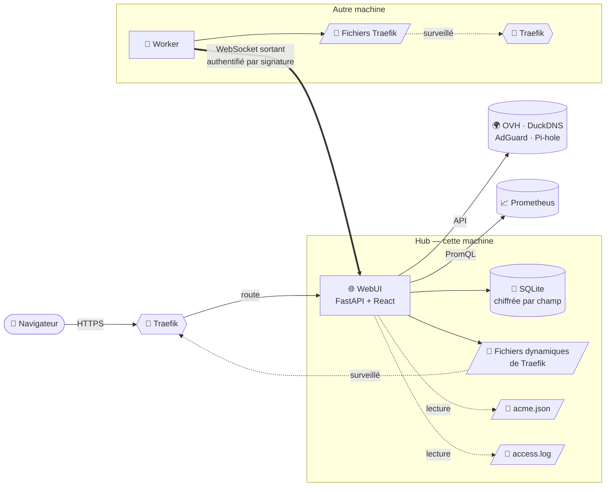
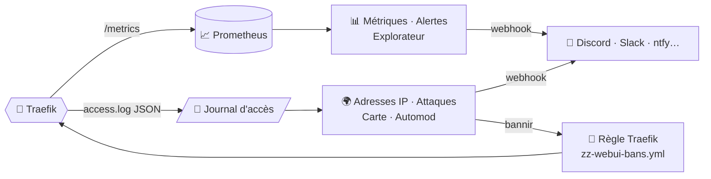
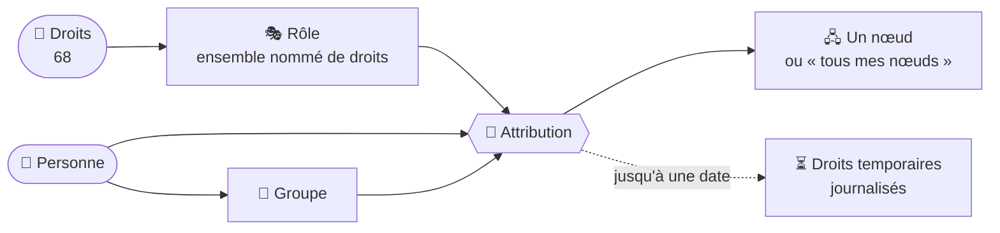
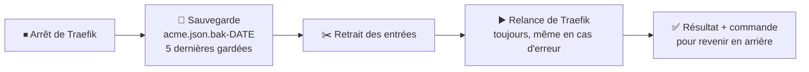
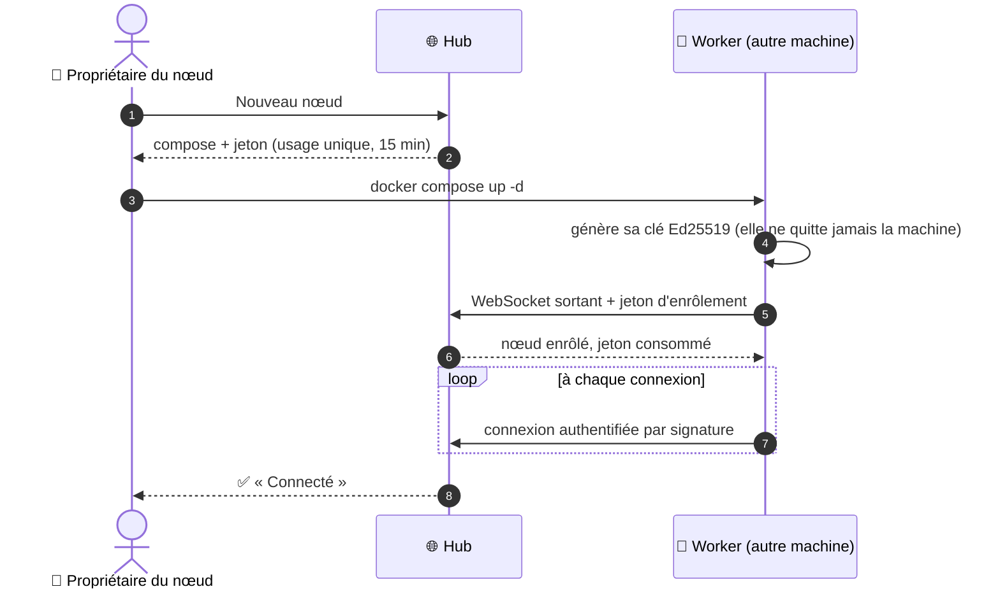

<div align="center">

# 🌐 Armadok

**Une seule interface, auto-hébergée, pour piloter vos zones DNS, votre Traefik _et_ votre Docker — depuis un ordinateur comme depuis un téléphone.**

Plus besoin d'écrire du YAML à la main, ni de jongler entre l'espace client de votre fournisseur DNS et un éditeur de texte :
un site créé dans Traefik peut créer son sous-domaine, et inversement.

[](LICENSE)
[](https://traefik.io/)
[](https://github.com/Dr-J-Watson/armadok/pkgs/container/armadok)
[](#-développement)
[](#-développement)
[](https://www.conventionalcommits.org/)

[✨ Fonctionnalités](#-fonctionnalités) ·
[🚀 Installation](#-installation) ·
[🔧 Configuration](#-configuration) ·
[📊 Surveillance](#-surveillance) ·
[🛡 Sécurité](#-sécurité) ·
[🛠 Développement](#-développement)

</div>

---

## 📑 Sommaire

<details open>
<summary><b>Tout le document, en un coup d'œil</b></summary>

| | Section | Pour… |
|:-:|---|---|
| ✨ | [Fonctionnalités](#-fonctionnalités) | savoir ce que fait l'outil |
| 🧭 | [Architecture](#-architecture) | comprendre comment les pièces s'emboîtent |
| 🚀 | [Installation](#-installation) | démarrer en quelques minutes |
| 🔧 | [Configuration](#-configuration) | régler les variables d'environnement |
| 🏗 | [Constructeur de piles Docker](#-constructeur-de-piles-docker) | générer vos fichiers `compose` et `.env` |
| 📊 | [Surveillance](#-surveillance) | métriques, alertes, adresses IP, bannissement, automod |
| 👥 | [Droits et utilisateurs](#-droits-et-utilisateurs) | rôles, droits fins, partage de domaines |
| 🌍 | [Fournisseurs DNS](#-fournisseurs-dns) | OVH, DuckDNS, AdGuard Home, Pi-hole, DNS local |
| 🔒 | [Certificats HTTPS](#-certificats-https) | les voir, les redemander, les renouveler |
| 📱 | [Sur téléphone](#-sur-téléphone) | application installable |
| 🐳 | [Gérer Docker](#-gérer-docker) | conteneurs, projets compose, Git, images, liaison avec Traefik |
| 🖧 | [Plusieurs Traefik](#-plusieurs-traefik) | nœuds, workers, accès d'urgence |
| 🗂 | [Fichiers Traefik](#-fichiers-traefik) | ranger, importer, désactiver, dossiers |
| ⚡ | [Temps réel](#-temps-réel) | l'écran se met à jour tout seul |
| 🛡 | [Sécurité](#-sécurité) | durcissements, 2FA, journal d'audit |
| 🧰 | [Exploitation](#-exploitation) | mise à jour, sauvegarde, commandes `make` |
| 🛠 | [Développement](#-développement) | contribuer, versions |

</details>

---

## ✨ Fonctionnalités

Une interface web **auto-hébergée** pour gérer au même endroit :

- 🌍 vos **zones DNS** (OVH avec plusieurs comptes, DuckDNS, AdGuard Home, Pi-hole, DNS local) ;
- 🚦 la **configuration dynamique de Traefik** (routeurs, services, middlewares), sans YAML à la main ;
- 🔗 et le **lien entre les deux** : un site créé dans Traefik peut créer son sous-domaine, et inversement ;
- 📊 la **surveillance** : métriques, alertes, adresses IP, attaques probables, bannissement automatique.

> [!NOTE]
> Pensée pour une **petite équipe** : comptes multiples, droits fins par nœud et par domaine, double authentification, le tout dans **un seul conteneur**.

### 🚦 Sites (Traefik)

- 🧱 Constructeur en **blocs** : *Quand on visite…* → *Alors appliquer…* → *Puis envoyer vers…* → HTTPS → DNS.
- ↕️ Middlewares réordonnables par glisser-déposer, avec des libellés lisibles.
- 🧪 **Tester un site en un clic** : le nom (DNS), le certificat et la réponse sont contrôlés pour chaque adresse.
- 📑 **Dupliquer** un site : on repart de ses réglages avec une adresse vide.
- 🛠 Mode avancé pour les administrateurs :
  - formulaires générés depuis le catalogue des options Traefik v3 (HTTP, TCP, UDP, TLS) ;
  - éditeur YAML (Monaco), **diff avant écriture**, historique et restauration ;
  - détection de problèmes (références cassées, doublons, boucles).
- 💬 Vos **commentaires** et la mise en forme de vos fichiers YAML sont conservés.

### 🌍 DNS

- Tous les types d'enregistrements, recherche, tri, sélection multiple, application automatique de la zone.
- Export / import, historique de zone, SOA, DNSSEC.
- Plusieurs comptes : chaque utilisateur peut brancher les siens.

### 🔗 Liens Traefik ↔ DNS

- Un hôte utilisé dans une règle Traefik mais **absent du DNS** est signalé, avec un bouton pour le créer.
- Un enregistrement DNS **sans site** peut devenir un site en un clic.

### 🧑‍💻 Au quotidien

| Pour… | Faites… |
|---|---|
| Chercher partout (sites, pages, domaines, certificats, adresse IP) | <kbd>Ctrl</kbd> + <kbd>K</kbd> ou <kbd>/</kbd> |
| Aller à une page | <kbd>g</kbd> puis <kbd>a</kbd> accueil · <kbd>s</kbd> sites · <kbd>d</kbd> domaines · <kbd>m</kbd> surveillance · <kbd>t</kbd> Traefik · <kbd>c</kbd> certificats |
| Créer un site | <kbd>n</kbd> |
| Voir tous les raccourcis | <kbd>?</kbd> |
| Agir sur un site | menu **⋯** de la carte : copier l'adresse, ouvrir, tester, statistiques, visiteurs, certificat, enregistrement DNS, dupliquer |

- 🖱 Chiffres, noms de sites, adresses et lignes d'activité sont **cliquables** ; un bouton « ← Retour » ramène d'où l'on vient.
- ↩️ **« Annuler »** reste proposé quelques secondes après un bannissement, une validation, une pause ou une sourdine d'alerte.
- 📤 **Export CSV** des adresses et des bannissements, tri des tableaux, filtres et périodes mémorisés.
- 🎓 Une **aide intégrée** pour débuter : parcours guidé, guide page par page, lexique, questions fréquentes (page **Aide**).

### 🛡 Équipe et sécurité

- Rôles administrateur / utilisateur, accès aux domaines en lecture ou en modification, partage par le propriétaire du domaine.
- Les administrateurs **ne voient pas** les clés ni les domaines ajoutés par un utilisateur, sauf partage.
- Accès Traefik délégué, limité aux domaines de l'utilisateur et aux cibles autorisées.
- Double authentification (TOTP) avec codes de secours, **exigible pour certains droits**.
- JWT à rotation, clés chiffrées en base, journal d'audit signé, sauvegarde de chaque fichier Traefik modifié.

---

## 🧭 Architecture



| Pièce | Rôle |
|---|---|
| **Hub** | l'interface complète : comptes, droits, DNS, surveillance. Un seul conteneur. |
| **Nœud** | une instance Traefik avec ses sites, ses membres et ses domaines. Le nœud « Principal » est celui de la machine du hub. |
| **Worker** | le même programme (`python -m app.worker`) sur une autre machine : il **se connecte** au hub, aucun port à ouvrir. |
| **Fichiers dynamiques** | ce que Traefik relit seul (`--providers.file.directory`) : l'interface les écrit, il recharge. |

---

## 🚀 Installation

### ✅ Prérequis

- [x] Docker avec **Docker Compose v2**, `make` et `openssl`.
- [x] **Traefik v3** avec le *provider file* sur un dossier (`--providers.file.directory=...`), et un réseau Docker partagé avec lui.
- [ ] Une clé API OVH *(facultatif au départ : voir [Clé API OVH](#-clé-api-ovh))*.

### 🪄 Installation guidée (recommandée)

```bash
mkdir armadok && cd armadok
curl -fsSLO https://raw.githubusercontent.com/Dr-J-Watson/armadok/main/Makefile
make install
```

Le script propose **quatre installations** :

| Choix | Ce qu'il fait | Écrit |
|---|---|---|
| **1 · Le hub, avec Docker Compose** | l'interface complète (DNS, sites Traefik, utilisateurs, nœuds) | `docker-compose.yml`, `.env`, `data/` |
| **2 · Le hub, dans Portainer** | la même interface, pour une pile Portainer ([détails](#-le-hub-dans-portainer)) | `docker-compose.stack.yml`, `stack.env` à copier-coller |
| **3 · Un worker, avec Docker Compose** | relie le Traefik de **cette** machine à un hub déjà installé ailleurs (voir [Plusieurs Traefik](#-plusieurs-traefik)) | `docker-compose.yml`, `.env`, puis démarre et attend la connexion |
| **4 · Un worker, dans Portainer** | la même chose pour un Traefik géré par Portainer | `docker-compose.stack.yml`, `stack.env` à copier-coller (rien n'est démarré) |

Chaque question est **expliquée** avant d'être posée, les questions facultatives se passent avec <kbd>Entrée</kbd>, et un **récapitulatif** est montré avant d'écrire quoi que ce soit.

> [!IMPORTANT]
> **Pour le hub, l'assistant ne démarre rien.** Il écrit les fichiers, puis indique la commande à lancer (`docker compose up -d`, ou `make up`). Seul le worker avec Docker Compose démarre tout de suite : son jeton d'enrôlement expire en 15 minutes et ne sert qu'une fois. Pour un worker dans Portainer, déployez la pile aussitôt les fichiers collés.

<table>
<tr>
<th width="50%">🏠 Le hub — questions posées</th>
<th width="50%">🔌 Un worker — déroulé</th>
</tr>
<tr valign="top">
<td>

1. **Traefik** : dossier de sa configuration dynamique, réseau Docker, points d'entrée et résolveur, dossier d'`acme.json` *(avec le socket Docker pour supprimer / renouveler, et son avertissement)*, journal d'accès, API de Traefik, Prometheus, IP par défaut *(tous facultatifs)* ;
2. **compte administrateur** (mot de passe de 12 caractères minimum) ;
3. **compte OVH** (facultatif) ;
4. **adresse de l'interface** (facultatif : crée le routage `armadok.yml`) ;
5. **récapitulatif**, puis écriture.

Le `.env` produit est rangé par étiquette (obligatoire, une fois, toujours, Compose).

</td>
<td>

1. votre Traefik (dossier ou volume Docker, certificats facultatifs, URL de l'API pour le statut en direct) ;
2. l'adresse du hub ;
3. le **jeton d'enrôlement**, demandé en dernier (il expire après **15 min** et ne sert **qu'une fois**) ;
4. écriture des fichiers, démarrage, **attente de la connexion**, jeton retiré du `.env`.

</td>
</tr>
</table>

> [!TIP]
> L'interface du hub (**Nouveau nœud**) affiche le jeton et une **commande déjà complète** (adresse et jeton inclus) : collée sur la machine distante, elle ne pose que les questions sur cette machine (Traefik, Docker, journal d'accès).

Dans les deux cas, l'UID/GID du dossier Traefik est repris automatiquement pour que le conteneur puisse y écrire. Pour sauter une question, passez sa réponse en variable :

```bash
make worker HUB_URL=https://… ENROLL_TOKEN=enr_… TRAEFIK_DYNAMIC_PATH=/chemin/dynamic
```

`make worker` demande d'abord **ce que le worker gère** : Traefik + DNS (le défaut), Docker seul, ou les deux (`WORKER_MODULES=traefik|docker|both` pour passer la réponse). Selon le choix, il pose les questions sur Traefik (dossier dynamique, certificats, **journal d'accès**, API) et/ou sur Docker (dossiers des projets, groupe du socket, terminal).

`make hub`, `make stack`, `make worker` et `make worker-stack` lancent directement l'un ou l'autre.

<details>
<summary><b>🐳 Le hub dans Portainer</b></summary>

<br>

Sur la machine de Portainer, `make stack` pose les mêmes questions que `make hub` mais **ne démarre rien** : il écrit deux fichiers à copier-coller.

```bash
make stack
```

| Fichier | À coller dans Portainer |
|---|---|
| `docker-compose.stack.yml` | **Stacks → Add stack → Web editor** |
| `stack.env` | plus bas, **Environment variables → Advanced mode** |

Puis **Deploy the stack**. Le script propose d'afficher les deux fichiers à la fin (`cat docker-compose.stack.yml stack.env`).

Ce qui diffère d'une installation par `make hub` :

- **Pas de `.env`** : la pile liste chaque variable en `${NOM}` et c'est Portainer qui les fournit (le `stack.env` est étiqueté comme le `.env`).
- **Les données vivent dans un volume nommé** `armadok_data` (comptes, clés chiffrées, audit) : à sauvegarder. Le conteneur démarre en root avec seulement `CHOWN`, `SETUID` et `SETGID`, donne `/data` à `PUID:PGID` puis abandonne ses droits.
- **Le hachage du mot de passe est fourni en base64** (`ADMIN_PASSWORD_HASH_B64`) : le `$` d'un hachage bcrypt est mal lu par certains éditeurs de variables.
- **Socket Docker** (supprimer / renouveler des certificats) : le groupe `docker` est conservé grâce à `PGROUPS`.
- Les chemins demandés (dossier de Traefik, `acme.json`, journal d'accès) sont vérifiés sur la machine où vous lancez la commande : lancez-la sur celle de Portainer.

> [!NOTE]
> `stack.env` contient les **secrets** : effacez-le une fois collé (Portainer les garde de son côté). Mise à jour : **Stacks → armadok → Pull and redeploy**.

</details>

<details>
<summary><b>🧩 Le worker dans Portainer</b></summary>

<br>

Deux façons d'obtenir la pile : sur la machine du Traefik, **`make worker-stack`** (mêmes questions que `make worker`, il écrit `docker-compose.stack.yml` et `stack.env` à coller dans *Stacks → Add stack*), ou **sans terminal**, depuis l'interface du hub, ci-dessous.

Dans **Nouveau nœud** (ou **Ce nœud → Connexion**), l'onglet *Portainer / compose* pose quelques questions :

- volume ou dossier de la configuration dynamique,
- réseau et API de Traefik,
- `PUID:PGID`,
- certificats (facultatif),

puis génère la **pile complète**, avec le hub et le jeton déjà inclus. Collez-la dans *Stacks → Add stack → Web editor*.

- Les volumes de Traefik existants sont déclarés `external` ; l'identité du worker vit dans un volume nommé.
- Le conteneur démarre en root avec seulement `CHOWN`, `SETUID` et `SETGID`, donne `/data` à `PUID:PGID` puis **abandonne ses droits** (`python -m app.drop`) : mettez l'UID:GID qui peut écrire dans la configuration dynamique de Traefik.

</details>

<details>
<summary><b>🛠 Installation manuelle</b></summary>

<br>

```bash
mkdir armadok && cd armadok
curl -O https://raw.githubusercontent.com/Dr-J-Watson/armadok/main/docker-compose.example.yml
curl -O https://raw.githubusercontent.com/Dr-J-Watson/armadok/main/.env.example
mv docker-compose.example.yml docker-compose.yml
cp .env.example .env
mkdir data
sudo chown $(id -u):$(id -g) data      # le conteneur écrit dans ce dossier
```

Dans le `.env` :

```bash
openssl rand -hex 32        # à mettre dans JWT_SECRET
openssl rand -hex 32        # à mettre dans ENCRYPTION_KEY
docker run --rm -it ghcr.io/dr-j-watson/armadok:latest python -m app.tools.hash_password
```

> [!IMPORTANT]
> La dernière commande affiche une ligne `ADMIN_PASSWORD_HASH='...'` à coller dans le `.env`, **guillemets simples compris**.

Renseignez aussi `TRAEFIK_DYNAMIC_PATH` (le dossier des fichiers dynamiques de Traefik) et `UID`/`GID` (le propriétaire de ce dossier : `id -u`, `id -g`).

Copiez [`armadok.example.yml`](armadok.example.yml) dans votre dossier dynamique Traefik, adaptez le domaine, le `certResolver` et les middlewares, puis :

```bash
docker compose up -d
```

</details>

### 🔑 Clé API OVH

Créez-la sur <https://api.ovh.com/createToken/> avec les droits `GET`, `POST`, `PUT`, `DELETE` sur `/domain/zone` et `/domain/zone/*`, **sans limite de durée**. Mettez les trois valeurs dans le `.env` (`OVH_APPLICATION_KEY`, `OVH_APPLICATION_SECRET`, `OVH_CONSUMER_KEY`). Pour générer la *consumer key* :

```bash
make consumer-key
```

> [!WARNING]
> **Protégez l'adresse de l'interface** (IP autorisées, SSO…) : elle peut modifier toute votre configuration Traefik.

> [!TIP]
> Pour essayer **sans clé OVH** : `OVH_MOCK=1` dans le `.env` simule des zones.

---

## 🔧 Configuration

Tout se règle dans le fichier **`.env`** (modèle commenté : [`.env.example`](.env.example)). Chaque variable accepte une variante `NOM_FILE` pour lire sa valeur dans un fichier (**secrets Docker**).

> [!TIP]
> **`make doctor`** vérifie l'ensemble : variables manquantes ou trop courtes, droits du `.env`, dossiers et propriétaire, réseau Docker, groupe `docker`, conteneur et API. Les `✗` sont à corriger, les `⚠` sont des conseils.

### 🧭 Quand une variable sert-elle ?

Quatre catégories, signalées par une étiquette dans le `.env` :

| Étiquette | Lue… | Pour la changer |
|---|---|---|
| **`OBLIGATOIRE`** | à chaque démarrage ; l'interface **refuse de démarrer** sans | modifier le `.env`, puis `make up` |
| **`UNE FOIS`** | **uniquement au tout premier démarrage** (création du nœud « Principal »), puis **ignorée** | **dans l'interface**, page *Ce nœud* — modifier le `.env` ne change plus rien |
| **`TOUJOURS`** | par l'application, à **chaque** démarrage | modifier le `.env`, puis `make up` |
| **`COMPOSE`** | par Docker Compose (chemins, réseau, utilisateur), pas par l'application | modifier le `.env`, puis `make up` |

### 1️⃣ Obligatoires

| Variable | Rôle |
|---|---|
| `ADMIN_USER`, `ADMIN_PASSWORD_HASH` | compte propriétaire (toujours administrateur). Le hachage : `make password`. `ADMIN_PASSWORD` en clair est accepté mais **déconseillé** |
| `ADMIN_PASSWORD_HASH_B64` | le même hachage **encodé en base64** (`printf '%s' '$2b$…' \| base64 -w0`), pour les éditeurs de variables qui lisent mal le `$` (Portainer). `ADMIN_PASSWORD_HASH` reste prioritaire |
| `JWT_SECRET` | secret de signature des sessions (32 caractères minimum) |
| `TRAEFIK_DYNAMIC_PATH`, `UID`, `GID` | *(Compose)* dossier des fichiers dynamiques de Traefik (ou volume Docker) et son propriétaire : l'interface tourne avec cet utilisateur (**jamais en root**) |

### 2️⃣ Valeurs de départ — lues **une seule fois**

Elles ne servent qu'à remplir le nœud « Principal » au premier démarrage. Ensuite, la base fait foi : **on les règle dans l'interface** (*Ce nœud*), le `.env` est ignoré.

| Variable | Rôle |
|---|---|
| `TRAEFIK_ENTRYPOINTS`, `TRAEFIK_CERT_RESOLVERS` | listes proposées dans les formulaires (séparées par des virgules) |
| `TRAEFIK_API_URL` | facultatif, ex. `http://traefik:8080` : statut en direct des routeurs (l'API doit être joignable) |
| `DEFAULT_DNS_TARGET` | IP proposée pour un nouveau sous-domaine si la zone n'a pas d'enregistrement A à la racine |
| `PROMETHEUS_URL` | facultatif, ex. `http://prometheus:9090` : métriques et alertes |

### 3️⃣ Toujours lues

| Variable | Rôle |
|---|---|
| `ENCRYPTION_KEY` | chiffre les clés et secrets en base (32 caractères minimum, **distincte** de `JWT_SECRET`). Si vide : dérivée de `JWT_SECRET`, avec un avertissement au démarrage. L'ajouter plus tard **migre** les données existantes. ⚠ La perdre rend ces données illisibles |
| `OVH_ENDPOINT`, `OVH_APPLICATION_KEY`, `OVH_APPLICATION_SECRET`, `OVH_CONSUMER_KEY` | compte OVH principal (facultatif : `make consumer-key`) |
| `ACCESS_TOKEN_MINUTES`, `REFRESH_TOKEN_DAYS` | durées de session (15 min / 7 jours par défaut) |
| `COOKIE_SECURE` | `true` par défaut ; ne le passez à `false` que pour un test en HTTP (il active aussi l'en-tête HSTS) |
| `FORWARDED_ALLOW_IPS` | proxys dont l'en-tête `X-Forwarded-For` est cru (adresses ou réseaux, séparés par des virgules). Défaut de l'image : `127.0.0.1` et les réseaux privés |
| `AUDIT_MAX_MB` | taille du journal d'audit avant archivage (`audit-000001.log`…), 50 par défaut |
| `GEOIP_DB` | chemin (dans le conteneur) d'une base DB-IP fournie par vous ; défaut : `data/geoip/dbip-city-lite.mmdb` |
| `DOCKER_SOCKET` | où joindre Docker pour relancer Traefik : le socket (défaut) ou un proxy de socket (`docker-proxy:2375`) |

> [!CAUTION]
> **Resserrez `FORWARDED_ALLOW_IPS` à l'adresse de Traefik** si vous la connaissez : sinon un autre conteneur du réseau pourrait falsifier l'adresse d'un visiteur (verrou de connexion, bannissements, journal).

### 4️⃣ Pour Docker Compose (chemins, réseau)

Ces variables construisent les montages du conteneur ; l'application ne les lit pas.

| Variable | Rôle |
|---|---|
| `TRAEFIK_NETWORK` | réseau Docker partagé avec Traefik (`proxy` par défaut) |
| `TRAEFIK_ACCESS_LOG_PATH` | facultatif : dossier de l'hôte **ou volume Docker** où Traefik écrit `access.log` (monté en **lecture seule**). Adresses IP, attaques probables. Un dossier doit exister **avant** `docker compose up` |
| `CERTS_PATH`, `DOCKER_GID` | facultatif : dossier qui contient `acme.json`, et groupe `docker` de la machine (seulement pour supprimer / renouveler) |
| `ARMADOK_IMAGE` | image à utiliser (posée par `make install`) |

### 🧱 Variables internes (ne pas les poser)

Le `docker-compose.yml` les définit, à ne pas changer : `TRAEFIK_DYNAMIC_DIR` (`/traefik-dynamic`), `DATA_DIR` (`/data`), `TRAEFIK_ACCESS_LOG` (`/traefik-logs/access.log`, avec le volume du journal), `TRAEFIK_CERTS_FILE` (`/traefik-certs/acme.json`) et `TRAEFIK_CONTAINER` (nom du conteneur de Traefik, relancé lors d'une suppression de certificat). `APP_VERSION` est posée par l'image.

### 🔌 Variables d'un worker

| Variable | Rôle |
|---|---|
| `HUB_URL`, `ENROLL_TOKEN` | adresse du hub (HTTPS) et **jeton à usage unique** (15 min) : `make worker` le **retire du `.env`** dès que le worker est connecté |
| `WORKER_ALLOW_INSECURE` | `1` pour accepter un hub en HTTP (essais, réseau de confiance seulement) |
| `TRAEFIK_API_URL` | *(toujours lue, côté worker)* API de Traefik, pour le statut en direct |
| `WORKER_MODULES` | ce que gère le worker : `traefik` (défaut), `docker` ou `traefik,docker` ; annoncé au hub à chaque connexion |
| `TRAEFIK_ACCESS_LOG` | *(worker)* fichier du journal d'accès de Traefik, monté en lecture seule : le worker le **lit et l'envoie au hub** (statistiques de visiteurs, adresses IP, alertes de ce nœud) |
| `PROJECT_ROOTS`, `DOCKER_SOCKET` | *(worker Docker)* dossiers des projets (montés au même chemin) et socket Docker |
| `WORKER_ADDRESSES` | adresses (IP ou noms, séparées par des virgules) par lesquelles le Traefik d'un autre nœud joint cette machine : relie ses conteneurs aux sites de ce Traefik |
| `WORKER_ALLOW_EXEC` | `true` pour autoriser le **terminal** dans les conteneurs de cette machine (refusé sinon, même si le hub le demande) |
| `PUID`, `PGID` | *(piles Portainer, worker et hub)* identité que prend le conteneur après avoir donné `/data` à ce compte |
| `PGROUPS` | *(pile Portainer du hub)* groupes supplémentaires conservés, séparés par des virgules : le groupe `docker`, pour joindre le socket |
| `CERTSYNC_IN`, `CERTSYNC_OUT`, `CERTSYNC_EVERY` | relais de certificats d'un worker (`python -m app.certsync`) : fichier lu, relevé écrit, période en secondes |

### 🧪 Développement et tests seulement

`OVH_MOCK=1` simule OVH ; `DNS_ALLOW_LOOPBACK=1` autorise 127.0.0.1 pour un serveur DNS local (refusé sinon).

---

## 🏗 Constructeur de piles Docker

L'onglet **Constructeur de piles** de l'**Aide** génère, à partir de cases à cocher, les fichiers à poser :

| Fichier généré | Contenu |
|---|---|
| **Traefik** — `docker-compose.yml` + `.env` | entrypoints et redirection, HTTP/3, provider Docker, API interne, tableau de bord, résolveurs de certificats HTTP et/ou DNS (OVH / DuckDNS / Cloudflare), serveur de test, métriques Prometheus, journal d'accès JSON |
| **Configuration dynamique** | chaîne privée, routeur de cette interface, tableau de bord |
| `prometheus.yml` | lecture des métriques de Traefik |
| **Cette interface** — `docker-compose.yml` + `.env` | lecture, suppression et renouvellement des certificats, montages, valeurs de départ du nœud |
| **Commandes** | celles à lancer, dans l'ordre |

- 📋 Chaque fichier se **copie** ou se **télécharge** ; des avertissements signalent les choix risqués (interface sans protection, tableau de bord public…).
- 🔒 **Tout est généré dans le navigateur** : rien n'est envoyé. Vos cases sont gardées localement ; les secrets (`JWT_SECRET`, `ENCRYPTION_KEY`, tirés au hasard) et le hachage du mot de passe ne sont **jamais enregistrés**.
- ✅ Les sorties sont vérifiées par `docker compose config` et par un vrai Traefik 3.7.

---

## 📊 Surveillance

Tout est **facultatif** : tant qu'une partie n'est pas branchée, elle est **cachée** de l'interface (pas de page vide), et l'aide (*Fonctionnalités facultatives*) explique comment l'activer.



| Fonction | Ce qu'il faut brancher | Ce que ça donne |
|---|---|---|
| 📈 **Métriques** | Traefik avec `--metrics.prometheus=true` (+ `addEntryPointsLabels`, `addServicesLabels`), Prometheus qui le lit, son adresse dans *Ce nœud* | Vue d'ensemble (requêtes/s, 4xx/5xx, latence p50/p95/p99, connexions, débit, certificats, cibles), tableau par site avec **statistiques détaillées** (période réglable ou libre) |
| 🔭 **Explorateur** | idem | questions courantes toutes prêtes, constructeur pas à pas (mesure, calcul, regroupement, filtres) ou **PromQL libre** ; actualisation automatique, courbes masquables, min / moyenne / max, export CSV, **un clic sur une étiquette isole la courbe** |
| 🔔 **Alertes** | Prometheus et/ou le journal d'accès ; webhook facultatif | **10 règles** réglables (voir ci-dessous), seuil / durée / gravité, historique 30 jours, signal en direct, **sourdine 1 h / 24 h**, webhook JSON (Discord, Slack, ntfy…), alertes natives de Prometheus en lecture seule |
| 🌍 **Adresses IP** | journal d'accès de Traefik en fichier (`TRAEFIK_ACCESS_LOG_PATH`, lecture seule) | qui se connecte et qui insiste (401/403/404, chemins typiques de balayage), détail par adresse, **7 jours** puis purge, chemins sans paramètres, **bannissement groupé**, export CSV |
| 🗺 **Carte** | + base de localisation | pays, ville approximative ; points colorés par pays, regroupés puis séparés au zoom ; clic = Détail · Valider · Bannir · **Ce pays** |
| 🕵 **Attaques probables** | le journal d'accès | chaque requête est comparée à des signatures ; **indices, pas verdicts** (voir ci-dessous) |
| 🤖 **Automod** | journal d'accès (+ base de localisation pour les pays) | règles « si… alors bannir » ; voir ci-dessous |
| ✅ **Adresses validées** | journal d'accès | « Valider » une adresse ou un réseau (≤ /16) : plus marquée suspecte, plus d'alerte, **non bannissable** ; le réseau local l'est d'office |
| 🙈 **Adresses masquées** | droit `security.ips.reveal` | sans lui, les adresses sont masquées **côté serveur** (`203.0.xxx.xxx`) partout ; on peut quand même bannir par une référence opaque |
| 🚫 **Bannissement** | rien | une règle Traefik `ClientIP(...)` de haute priorité → **403** sur tous les sites du nœud (HTTP et HTTPS) ; durée **modifiable**, expiration automatique ; vérifié sur Traefik 3.7 |

<details>
<summary><b>🔔 Les 10 règles d'alerte</b></summary>

<br>

| Règle | Source |
|---|---|
| Trop d'erreurs serveur (5xx) | Prometheus |
| Lenteur | Prometheus |
| Certificat bientôt expiré | Prometheus |
| Cible Prometheus injoignable | Prometheus |
| Configuration refusée par Traefik | Prometheus |
| Serveur hors service | Prometheus |
| Pic de trafic | Prometheus |
| *Une adresse insiste* (trop d'erreurs 401/403/404 en 10 min) | journal d'accès |
| *Tentative d'exploitation* (tentatives graves cumulées en 10 min) | journal d'accès |
| *Fichier sensible servi* (un `.env`, `.git`… a répondu **200** : fuite possible, alerte **critique**) | journal d'accès |

</details>

<details>
<summary><b>🕵 Les attaques reconnues</b></summary>

<br>

Signatures : fichiers sensibles, balayage d'applications (CMS), remontée de répertoires, injection SQL, XSS, exécution de commandes (Log4Shell…), outils connus (sqlmap, nikto…). Types **déduits** : essai de mots de passe, énumération, inondation.

Étiquettes par adresse, filtre par type, alertes. Les paramètres des requêtes sont analysés mais **jamais conservés**.

</details>

<details>
<summary><b>🤖 Automod : bannir automatiquement</b></summary>

<br>

Des règles du type *« si le pays est… / l'adresse est suspecte / type d'attaque / volume → alors bannir »*.

- **5 modèles** prêts à l'emploi, jusqu'à 30 règles par nœud.
- **Observation d'abord** : la règle journalise ce qu'elle *aurait* banni, sans rien bloquer. Un aperçu montre l'effet avant d'enregistrer.
- Garde-fous : **25 adresses au plus par passe**, jamais le réseau local ni une adresse validée, jamais une adresse qui porte une **part énorme du trafic** (proxy ou CDN), mêmes limites que les bannissements manuels. Une adresse dont le pays est inconnu n'est **jamais** bannie par une condition de pays.
- « **Bannir ce pays** » depuis la carte ou la fiche d'une adresse crée la règle pour vous.

</details>

<details>
<summary><b>📐 Détails et garde-fous</b></summary>

<br>

- **Localisation** : un bouton télécharge la base locale **DB-IP City Lite** (CC BY 4.0, ≈ 130 Mo, dans `DATA_DIR/geoip`, ou `GEOIP_DB`) : rien n'est envoyé à un service tiers.
- **Source des adresses** : Prometheus ne sait pas compter par visiteur, les adresses viennent du **journal d'accès**. Avec `accesslog.filepath`, Traefik n'écrit plus les accès sur sa sortie standard ; prévoyez une rotation (`copytruncate`). Les accès sur l'entrypoint interne `traefik` sont ignorés.
- **Garde-fous du bannissement** : jamais d'adresse privée ou locale, jamais celle de la personne qui bannit, réseaux jusqu'à /16 (IPv4) seulement, 200 bannissements au plus.
- **Derrière un autre proxy** (Cloudflare…), Traefik voit l'adresse du proxy : configurez ses en-têtes de confiance.
- **Droits dédiés** : `metrics.view`, `metrics.explore`, `alerts.view`, `alerts.manage`, `security.view`, `security.ips.reveal`, `security.ban`, `security.automod` (par défaut : propriétaire et administrateur ; le rôle *Auditeur* voit tout sauf les adresses).
- **Portée** : les **métriques** (Prometheus) ne concernent que le nœud principal. Les **adresses IP, statistiques de visiteurs, attaques probables, alertes tirées du journal et règles automatiques** marchent aussi sur un nœud distant dont le worker lit le journal d'accès (`TRAEFIK_ACCESS_LOG`) ; le bannissement marche sur tous les nœuds.
- L'adresse de Prometheus et le webhook se règlent dans *Ce nœud* (administrateur de la plateforme : le serveur appelle lui-même ces adresses ; redirections jamais suivies).

</details>

---

## 👥 Droits et utilisateurs

### Les rôles de base

| Rôle | Peut… |
|---|---|
| 👑 **Propriétaire** | défini dans le `.env`, administrateur permanent |
| 🧑‍💼 **Administrateur** | voit et modifie tout Traefik, gère les utilisateurs et les domaines du compte principal |
| 🙂 **Utilisateur** | n'accède qu'aux domaines partagés avec lui (lecture, ou modification des enregistrements) |
| ➕ **Peut ajouter des domaines** | branche ses propres clés (page *Comptes DNS*), importe ses zones et décide qui y accède |

**Accès Traefik par nœud** (propriétaire, administrateur, éditeur, lecteur) : un **éditeur** crée des sites uniquement sur les domaines où il peut écrire, avec une règle limitée à des `Host(...)` précis, des middlewares existants, et des cibles dans la liste que l'administrateur du nœud autorise (ex. `mon-app-*, 192.168.1.*`). Sans cette liste, il ne peut que réutiliser des services existants.

### Droits fins (page « Droits »)

**68 droits** répartis en groupes : portée sur Traefik, sites, middlewares, services, transports, TLS, fichiers bruts, certificats, DNS, surveillance, administration du nœud.



- 🎭 **Rôle** : les prédéfinis (propriétaire, administrateur, éditeur, lecteur, domaines, opérateur, auditeur) ne se modifient pas mais se **dupliquent**.
- 👥 **Groupe** : réunit des personnes.
- 📌 **Attribution** : donne un rôle à une personne ou à un groupe, sur **un nœud ou sur « tous mes nœuds »** (y compris les futurs), éventuellement **jusqu'à une date**.

> [!IMPORTANT]
> **Garde-fous** : on ne donne jamais plus de droits qu'on n'en a soi-même ; un droit n'existe que si ce dont il dépend existe (créer un site exige de les voir) ; transférer ou supprimer un nœud reste réservé au propriétaire.

- Pour le DNS, le partage d'un domaine accepte en plus des **types d'enregistrements autorisés**, des **sous-domaines autorisés** (`app, *.dev`), l'interdiction de supprimer, et une durée.
- À la mise à jour, chaque rôle d'avant garde **exactement** ses droits (vérifié par les tests). Les écrans n'affichent que ce que la personne peut utiliser ; le serveur refuse le reste avec *« Droit manquant : … »*.
- 🔐 Le propriétaire d'un nœud peut **exiger la 2FA pour certains droits** : voir [Sécurité](#-sécurité).

---

## 🌍 Fournisseurs DNS

Chaque domaine a un **fournisseur**, et l'interface s'adapte à ce qu'il sait faire (page **Comptes DNS** → *Ajouter*).

| Fournisseur | Ce qu'il faut | Ce que l'interface fait |
|---|---|---|
| 🟦 **OVH** | clé API OVH | zone complète : enregistrements créés / modifiés / supprimés, import-export, historique, DNSSEC, détection du « DNS manquant » |
| 🦆 **DuckDNS** | jeton DuckDNS + noms `xxx.duckdns.org` | une adresse IP (v4/v6) et un TXT par nom ; tous les sous-domaines la suivent, donc jamais de « DNS manquant » ; bouton « IP publique de ce serveur » |
| 🛡 **AdGuard Home** | adresse de son interface (ex. `http://adguard:3000`), identifiant, mot de passe, domaines à lui confier | les *réécritures DNS* servent d'enregistrements **A / AAAA / CNAME** (jokers `*.sous.domaine` compris), vers l'adresse de votre choix (IP privée de Traefik), **rien n'est publié**. Pas de TTL, de TXT ni de MX, rien à « appliquer » ; bouton *Tester* |
| 🕳 **Pi-hole** (v6) | adresse de son interface (ex. `http://pihole`), mot de passe (pas d'identifiant ; un *mot de passe d'application* si la 2FA est active), domaines à lui confier | même principe qu'AdGuard : « DNS local » (A / AAAA) et CNAME servent d'enregistrements ; **pas de jokers** ; session renouvelée toute seule ; Pi-hole 5 non pris en charge |
| 🏠 **DNS local** | rien (aucun compte, aucune clé) | le domaine est un simple nom pour les sites et les droits ; rien n'est créé ni publié, aucun avertissement DNS. C'est **votre** DNS (Pi-hole, AdGuard, routeur…) qui le résout |

### Qui peut ajouter quoi

- Le droit global « ajouter des comptes / domaines » (*Équipe*) permet d'en ajouter sur les nœuds où l'on est membre.
- Un **propriétaire ou administrateur de nœud** peut aussi en ajouter pour son propre nœud, sans ce droit.
- Un compte DNS appartient à **l'utilisateur, pas à un nœud** : on peut l'ajouter sans en avoir. Ses domaines sont alors marqués « pas encore sur un nœud » et se rattachent plus tard (*Ce nœud → Domaines → importer*) sans rien recréer ; ils ne servent aux sites qu'une fois rattachés.
- L'ajout se fait depuis *Comptes DNS* ou depuis la page *Domaines* (bouton *Ajouter un domaine*). Les domaines (de tout fournisseur) se partagent et s'importent sur d'autres nœuds.
- Un domaine appartient à **un seul** compte : pour des noms locaux sous un domaine déjà chez OVH, confiez à AdGuard un **sous-domaine dédié** (ex. `local.exemple.fr`) ; c'est le plus précis qui s'applique.

> [!NOTE]
> **Ce que l'interface contacte.** DuckDNS : uniquement `www.duckdns.org`. **AdGuard Home et Pi-hole** sont les seules exceptions : le serveur appelle l'adresse que vous indiquez (réseau local voulu), réservée à ceux qui peuvent ajouter un compte DNS. Identifiants chiffrés, redirections jamais suivies, adresses de métadonnées cloud (169.254.x.x) et boucle locale refusées. Le jeton DuckDNS est chiffré en base et jamais renvoyé au navigateur.

### Certificats d'un domaine

Les certificats restent l'affaire de **Traefik** (défi DNS, CA interne ou défi HTTP) : ses clés OVH / son jeton DuckDNS sont dans **son** environnement, pas dans celui de cette interface. Le bouton *Certificats* de chaque domaine affiche les variables et l'extrait de configuration adaptés au fournisseur, dont le **certificat joker** (`*.domaine`). C'est ce qui permet un vrai certificat HTTPS pour des sites résolus par un DNS local, sans créer de sous-domaine public.

---

## 🔒 Certificats HTTPS

L'interface lit `acme.json` **directement** (aucun service « relais » à part) : onglet **Traefik avancé → Certificats**, avec échéances, jokers, sites sans certificat, et une pastille HTTPS sur chaque site. Elle n'en extrait que les **noms, l'émetteur et les dates** : les clés privées ne sont jamais envoyées au navigateur. Un éditeur ne voit que les certificats de ses domaines.

### Montage (facultatif)

```yaml
    environment:
      TRAEFIK_CERTS_FILE: /traefik-certs/acme.json
      TRAEFIK_CONTAINER: traefik            # relancé quand on supprime / renouvelle un certificat
    volumes:
      - ${CERTS_PATH}:/traefik-certs         # le dossier qui contient acme.json
      - /var/run/docker.sock:/var/run/docker.sock   # facultatif : seulement pour supprimer / renouveler
    group_add: ["${DOCKER_GID}"]            # getent group docker | cut -d: -f3
```

L'interface utilise le même utilisateur (`UID:GID`) que Traefik, donc lit `acme.json` (mode 600) sans privilège particulier. Les nœuds distants gardent le petit relais en lecture seule (`python -m app.certsync`).

### Gérer les certificats

Avec le droit `certs.manage` (propriétaire et administrateur) :

| Action | Effet |
|---|---|
| 🔁 **Redemander** | pour un site qui n'a pas de certificat : un changement de configuration sans effet fait ré-évaluer à Traefik les noms sans certificat. **Aucun redémarrage** ; le site doit avoir un résolveur. Marche aussi sur un nœud distant |
| 🗑 **Supprimer** / ♻️ **Renouveler** | un ou **plusieurs** certificats (cases à cocher, « Sélectionner les expirés ») ; **une seule coupure** de Traefik pour tout le lot. Local au nœud principal |



> [!NOTE]
> Traefik garde `acme.json` en mémoire et le réécrit en entier : une entrée retirée **pendant qu'il tourne** est servie quand même, puis revient. D'où l'arrêt / relance, qui prend quelques secondes. Un certificat retiré dont le site existe encore est **redemandé** par Traefik à son démarrage (c'est le renouvellement) ; Let's Encrypt limite à **5 certificats identiques par semaine**.

> [!CAUTION]
> **Donner le socket Docker à l'interface lui donne la main sur Docker.** Ne le faites que si elle est protégée (chaîne privée), et voyez [le proxy de socket](#-à-savoir-sur-le-socket-docker). Sans le socket, tout marche **sauf** supprimer / renouveler.

### 🐳 Volume Docker au lieu d'un dossier

Partout où l'installation demande « le dossier des fichiers dynamiques de Traefik », vous pouvez donner **un chemin absolu** ou **le nom d'un volume Docker existant** (`docker volume ls`). Pour un volume, le Makefile déclare le volume `external`, lit son propriétaire par un conteneur jetable et, s'il appartient à root, propose de le céder à `1000:1000` pour que l'interface n'y tourne pas en root (Traefik continue de le lire normalement). Le routage `armadok.yml` est écrit dans le volume de la même façon. Même principe pour le worker.

---

## 📱 Sur téléphone

Armadok est une application web **installable** : sur Android (Chrome) « Ajouter à l'écran d'accueil » / « Installer l'application », sur iPhone (Safari) « Sur l'écran d'accueil ». Elle s'ouvre alors en plein écran, avec sa barre de navigation en bas, pour tout piloter à distance (sites, DNS, conteneurs, projets, fichiers, journaux, terminal). Le titre de l'onglet change avec la page.

## 🐳 Gérer Docker

> [!CAUTION]
> **Donner Docker à l'interface lui donne un accès équivalent à *root* sur la machine.** La fonction est **désactivée par défaut**, réservée à ceux qui reçoivent les droits `docker.*` / `projects.*` (avec 2FA possible), et **tout est audité**. Le terminal dans un conteneur n'est donné à personne d'office, pas même aux administrateurs.

Un onglet **Projets** et une page **Docker** s'ajoutent aux nœuds qui gèrent Docker. Le but n'est pas « un Portainer à côté » mais **la liaison avec Traefik** : depuis un conteneur ou un projet, on voit ses règles Traefik, son site, ses statistiques d'accès et **les adresses IP qui y sont venues**, et inversement.

### Ce qu'on y trouve

| Où | Ce qu'on fait |
|---|---|
| **Docker** | conteneurs (démarrer, arrêter, redémarrer, journaux en direct, statistiques, terminal), **images** (détail : couches, ports, utilisateurs), **réseaux** (détail, créer, relier ou détacher un conteneur), **volumes** (détail et contenu en lecture seule, droit `docker.exec`), nettoyage |
| **Projets** (cartes, 3 par ligne) | les dossiers `docker compose` : état, services, sites, CPU, mémoire, requêtes, erreurs, visiteurs |
| fiche d'un projet | vue d'ensemble · services · **fichiers** (explorateur coloré par type — compose, `.env`, Makefile, Dockerfile en évidence —, créer / renommer / déplacer / supprimer des fichiers et des dossiers, éditeur, diff, historique, `.env` protégé) · **déploiement** (up, down, pull, build…) · journaux · **accès et IP** · sites · **Git** · **images** |
| **Labels ⇄ fichier** | convertit les labels `traefik.*` d'un compose en fichier YAML de Traefik (et l'inverse), avec contrôles croisés |
| **Publier sur Traefik** | depuis un conteneur : l'assistant de site s'ouvre directement, prérempli (une alerte rappelle si Traefik ne peut pas atteindre le conteneur) |
| **Installer Traefik** | si le hub n'en détecte aucun, la page Projets propose de créer un projet Traefik (e-mail Let's Encrypt, réseau, HTTPS automatique, protections, journal d'accès…) sans rien démarrer avant relecture |
| **Plusieurs fichiers compose** | un dossier avec un `override` ou des variantes (`prod`, `dev`…) : par défaut Armadok lance comme `docker compose up` (principal + override) ; sinon il demande quels fichiers fusionner et peut retenir le choix. L'arrêt et le redémarrage reprennent les fichiers du dernier lancement |
| **Makefile du projet** | onglet qui liste les cibles avec leur description (`cible: ## texte` ou commentaire au-dessus) et les lance, sortie en direct ; droit « terminal » requis (les commandes s'exécutent dans le conteneur d'Armadok : `make`, `docker`, `git`) |
| **Sites via le Traefik d'un autre nœud** | pour un worker « Docker seul » : `Ce nœud` → Docker → « Publier les sites avec le Traefik de… » (le hub, par exemple). Ses conteneurs sont reliés automatiquement aux règles de ce Traefik (adresse de la machine + port publié), avec leurs visiteurs ; « Publier sur Traefik » crée le site sur ce Traefik, vers l'adresse de la machine. L'adresse se donne avec `WORKER_ADDRESSES` (demandée par `make worker`) ou dans les réglages du nœud |
| **Services « init »** | un service qui s'est arrêté normalement (code 0) est marqué « Terminé » et ne déclenche plus d'alerte |

### Activer (hub)

L'installation guidée (`make install`) pose la question. À la main, dans le `.env` **et** le compose :

```bash
# .env
DOCKER_MANAGE=true
PROJECT_ROOTS=/opt/stacks,/srv/apps   # chemins absolus, montés avec le MÊME chemin dans le conteneur
DOCKER_GID=984                        # stat -c %g /var/run/docker.sock
```

```yaml
# docker-compose.yml, service armadok
volumes:
  - /var/run/docker.sock:/var/run/docker.sock
  - /opt/stacks:/opt/stacks
  - /srv/apps:/srv/apps
group_add: ["${DOCKER_GID}"]
```

Les deux sont nécessaires : le socket **seul** (monté pour les certificats) n'active rien.

### Droits

| Droit | Permet | Par défaut |
|---|---|---|
| `docker.view` · `docker.logs` | voir, lire les journaux | administrateur |
| `docker.control` · `docker.remove` | démarrer / arrêter, supprimer et nettoyer | administrateur |
| `docker.exec` | **terminal** dans un conteneur | propriétaire seulement |
| `projects.view` · `import` · `files` | voir, importer (sans rien toucher au disque), lire les fichiers | administrateur |
| `projects.deploy` · `edit` · `git` | déployer, modifier les fichiers, Git et images | administrateur |
| `projects.env` | voir et modifier le `.env` (secrets) | administrateur |
| `projects.delete` | supprimer le dossier d'un projet | propriétaire seulement |

Le propriétaire d'un nœud peut les accorder à un membre (« Droits »), et exiger la 2FA pour les plus sensibles.

### Plusieurs nœuds : trois types de worker

Dans **Nouveau nœud**, on choisit ce que gère le worker : **Traefik + DNS** (le défaut), **Docker seul**, ou **les deux**. L'assistant génère la pile (socket, groupe, dossiers des projets). L'affichage s'adapte : un nœud « Docker seul » n'affiche ni Sites ni Certificats ; un nœud « Traefik seul » n'affiche pas Docker.

**Un conteneur sur une machine, servi par le Traefik d'une autre** : indiquez les **adresses de la machine** (« Ce nœud » → Docker). Quand le Traefik d'un autre nœud vise `adresse:port` et que le conteneur publie ce port, le lien est trouvé tout seul, avec les statistiques lues sur le journal d'accès du nœud qui sert le site.

### Terminal, Git en SSH, webhook

- **Terminal** : sur le nœud du hub, ou sur un worker **à condition que son administrateur l'ait autorisé** (`WORKER_ALLOW_EXEC=true`). Sur un worker, le hub ouvre la session chez lui et l'interroge par de courtes lectures (un peu de latence en plus) ; le shell lancé est toujours le même, jamais une commande choisie par le hub.
- **Git en SSH** : par projet (onglet Git → « Clé SSH de déploiement ») ou pour tout le nœud (fenêtre « Cloner » avec une adresse SSH). L'interface génère une clé Ed25519 ; vous donnez la partie **publique** au dépôt (« Deploy key », lecture seule). La clé privée est chiffrée en base, n'est jamais renvoyée au navigateur et n'est écrite sur la machine du projet que le temps d'une commande Git. Le serveur est mémorisé au premier contact (`known_hosts` dans le dossier personnel de l'application).
- **Webhook** : onglet Git → « Récupération automatique ». À chaque envoi sur le dépôt, celui-ci appelle `https://hub/api/hooks/git/<n° du projet>` ; le hub vérifie la **signature** (GitHub `X-Hub-Signature-256`, Gitea / Gogs, ou le `X-Gitlab-Token` de GitLab), fait un `git pull --ff-only`, et relance `docker compose up -d` si vous l'avez demandé. Le secret n'est montré qu'une fois ; trop d'échecs mettent la source en attente ; un appel par projet toutes les 10 secondes au plus.

### Limites à connaître

- **Suivi des images** : registres **publics** seulement (comparaison d'empreinte, rien n'est téléchargé) ; vérification quotidienne facultative (`IMAGE_CHECK_HOURS`) avec notification par le webhook du nœud.
- **Git** : pas de sondage automatique des dépôts (le webhook le remplace) ; une clé SSH par projet ou par nœud, pas de clé protégée par mot de passe.
- **Statistiques d'accès d'un nœud distant** : elles viennent du journal d'accès que son worker envoie (`TRAEFIK_ACCESS_LOG`) ; sans lui, le nœud n'a ni visiteurs ni IP. Les 2 derniers Mo du journal sont lus au premier envoi, puis la suite au fil de l'eau (position gardée sur le worker).

---

## 🖧 Plusieurs Traefik

Un **nœud** est une instance Traefik avec ses propres sites, membres et domaines. Le nœud « Principal » est celui de cette machine (réglages du `.env`, modifiables ensuite dans **Ce nœud**). Pour gérer un Traefik sur **une autre machine**, on y installe un **worker** : le même programme, lancé avec `python -m app.worker`.

### Ajouter un nœud

1. Dans le menu des nœuds, **Nouveau nœud** *(réservé aux comptes qui en ont le droit : **Équipe → Nœuds qu'il peut créer**, un nombre ou illimité)*.
2. L'assistant affiche un `docker-compose.yml` prêt à copier, avec un **jeton à usage unique** valable 15 minutes.
3. Sur la machine distante : `docker compose up -d`. L'assistant détecte la connexion tout seul.



### Ce qu'il faut savoir

- 🔌 Le worker **se connecte au hub** (WebSocket sortant en HTTPS) : **aucun port à ouvrir** côté distant, il peut être derrière un NAT. Le hub doit être joignable en HTTPS (Traefik laisse passer les WebSocket par défaut).
- 🔐 Il n'exécute qu'une **liste fermée d'opérations sur fichiers**, **uniquement dans son dossier Traefik**, et ne connaît ni les clés DNS, ni les utilisateurs, ni le secret du hub.
- 👑 Chaque propriétaire de nœud gère lui-même ses membres ; un administrateur de la plateforme n'a **pas** d'accès implicite aux nœuds distants des autres.
- 🌍 Un domaine peut être **importé** sur plusieurs nœuds sans copier ses clés (**Ce nœud → Domaines**). **Ce nœud → Connexion** permet de remplacer ou révoquer un worker, ou de supprimer le nœud.
- 💡 Sur la machine distante, le plus simple est `make install` puis « worker » ; l'assistant « Nouveau nœud » affiche aussi la commande toute prête.

### 🚨 Accès d'urgence (administrateurs de la plateforme)

La page **Tous les nœuds** liste tous les nœuds ; pour intervenir sur l'un d'eux :

| | Accès d'urgence | Actions rapides |
|---|---|---|
| **Exigences** | motif obligatoire (≥ 10 caractères), **2FA activée** et code valide | code 2FA **à chaque fois**, aperçu de l'impact, confirmation en tapant le nom du nœud |
| **Durée** | session de **30 minutes**, droits d'administrateur du nœud | immédiat |
| **Traçabilité** | le propriétaire reçoit un **avis non supprimable** (motif + actions faites) ; il peut l'acquitter, jamais l'effacer | journal d'audit |
| **Possibilités** | tout ce que fait un administrateur du nœud | suspendre / reprendre, couper le worker, bannir le propriétaire, supprimer le nœud (récupérable **30 jours**) avec ou sans bannissement, restaurer, purger, reprendre la propriété, retirer le droit de créer des nœuds |

> [!NOTE]
> Le bannissement d'un propriétaire est immédiat et suspend ses nœuds. Les enregistrements DNS ne sont **jamais** modifiés par ces actions.

---

## 🗂 Fichiers Traefik

Tout se passe dans **Traefik avancé → Fichiers**.

### 📁 Dossiers (facultatif, par nœud)

Arborescence repliable (jusqu'à 4 niveaux), recherche, création / renommage / suppression de dossiers (seulement vides), déplacement d'un fichier par glisser-déposer ou via « Déplacer » (l'historique suit). Un nœud « à plat » propose en un clic `apps`, `infra` et `middlewares`.

Les nouveaux éléments sont rangés d'après ce qui existe déjà : `apps/` s'il existe (sinon le dossier qui contient déjà vos routeurs), `middlewares/` pour les middlewares ; sans dossier, tout reste à la racine. Chaque nœud (y compris distant) a sa propre arborescence.

<details>
<summary><b>🪄 « Ranger mes fichiers » — l'assistant</b></summary>

<br>

L'assistant propose, **vous cochez**, puis tout est appliqué d'un coup (**copie de sécurité avant** : les 5 dernières sont gardées dans `data/backups/_reorg/`). Fonctionne aussi sur les nœuds distants.

> [!IMPORTANT]
> Il ne touche **jamais** aux fichiers dont le nom commence par `zz` (`zz-webui-bans.yml`, `zz-webui-nudge.yml`…) : ce sont ceux que l'interface gère elle-même, comme les fichiers `.off`.

**Trois dispositions au choix :**

| Disposition | Résultat |
|---|---|
| **Un fichier par site** *(par défaut)* | chaque service est rangé avec **tous** les routeurs qui le visent (même dispersés ou dans un gros fichier) ; si une partie du site est déjà dans un dossier, le reste la rejoint |
| **Routeurs / services séparés** | un fichier par routeur dans `routers/`, un par service dans `services/` |
| **Fichiers entiers** | on ne touche pas au découpage |

**Réglages :**

- Par défaut, l'assistant liste **tous** les blocs, y compris ceux déjà rangés ; décochez « Ranger aussi ce qui est déjà dans des dossiers » pour ne traiter que la racine. Relancé après application, il n'a plus rien à proposer.
- **Sous-dossiers** (activé par défaut) : middlewares par type (`middlewares/auth/`, `headers/`, `ip/`, `chains/`, `redirections/`, `limites/`) et sites par domaine (`apps/exemple.fr/`). Les réglages TLS vont dans `tls/`.
- Les fichiers touchés sont réécrits **sans commentaires** (décochable) ; les fichiers qui se retrouvent vides sont supprimés ; les blocs désactivés suivent leur groupe en restant désactivés.
- Le **contenu** des blocs n'est jamais modifié ; les fichiers déplacés en entier restent intacts (commentaires compris). Les sites déjà dans un dossier ne bougent jamais.

</details>

### 📥 Importer, glisser-déposer, télécharger

Le bouton d'import (ou un glisser-déposer de `.yml` depuis l'ordinateur, sur la liste ou sur un dossier précis) ajoute des fichiers. Le serveur **valide le YAML** ; un fichier existant n'est remplacé qu'après confirmation, et son ancienne version reste dans l'historique. Le bouton « Télécharger » de l'éditeur enregistre le fichier affiché. Glisser un fichier de la liste sur un dossier le range toujours.

### ⏸ Activer / désactiver (réversible)

Un **interrupteur** sur les routeurs, services, middlewares et options TLS (onglets Traefik, page Middlewares, et page **Sites** pour mettre un site en pause), sur les **fichiers entiers** et sur un **domaine** (page DNS : met en pause tous ses sites, sans toucher au DNS).

- Le bloc reste dans son fichier, en commentaire (`#~ …`) ; un fichier désactivé devient `nom.yml.off`, que Traefik ignore.
- Les **dépendances suivent**, avec un aperçu avant de valider : un service coupé coupe les routeurs qui l'utilisent ; un middleware ou une option TLS coupé disparaît des listes qui le référencent (liste d'origine gardée dans une note `#% ref …`, rétablie à la réactivation) ; un groupe de middlewares sans membre actif se met de côté et revient avec son premier membre.
- Tout se réactive **à l'identique**, y compris au niveau du fichier. Un éditeur ne peut mettre en pause que ses propres sites.
- Les éléments désactivés restent visibles (grisés), n'apparaissent plus dans les problèmes ni dans le DNS manquant, et leur nom reste réservé.

> [!NOTE]
> Limite : un bloc écrit en YAML « en ligne » sur une seule ligne (`routers: {a: {…}}`) n'est pas modifié (message d'erreur, rien n'est écrit) ; une liste de middlewares en ligne est réécrite au format JSON à la réactivation (même contenu).

### 🔄 Sous-dossiers et rechargement

Traefik ne détecte pas toujours les modifications faites dans les sous-dossiers du dossier dynamique. Si l'interface en trouve, elle réécrit un petit fichier `reload` à la racine après chaque enregistrement pour forcer le rechargement. Avec un dossier à plat, rien n'est créé.

> [!TIP]
> Après une modification **à la main** dans un sous-dossier : `date > reload` à la racine du dossier dynamique.

---

## ⚡ Temps réel

L'interface ouvre un **WebSocket** (`/api/events`, même hôte, authentifié par le jeton d'accès) et se met à jour **toute seule** quand quelque chose change, même fait ailleurs.

| Ce qui change | Ce qui se passe |
|---|---|
| Un fichier Traefik modifié (à la main, ou par un autre utilisateur ; hub **et** worker) | la liste se recharge ; dans l'éditeur, le fichier est rechargé tout seul, ou signalé si vous avez des changements en cours |
| L'état d'un routeur, le relevé des certificats | mise à jour des pastilles |
| Un worker se connecte, domaines et comptes DNS, équipe, activité | mise à jour de l'écran concerné |
| Un compte désactivé, modifié ou supprimé | **agit tout de suite** sur ses sessions ouvertes (désactivé = déconnecté) |
| Un accès d'urgence | un avis s'affiche aussitôt chez le propriétaire |
| Un site enregistré | un second message confirme que Traefik l'a **bien rechargé** (ou donne son erreur) |
| Un site modifié ailleurs pendant que vous l'éditez | signalé ; l'enregistrement demande confirmation avant d'écraser |

- 🔒 Le serveur n'envoie que des **signaux** (« traefik », « nodes »…) **sans aucune donnée** : l'écran se recharge par l'API, qui applique les droits, et un utilisateur ne reçoit que les signaux des nœuds auxquels il a accès.
- 🟢 Un témoin « Temps réel » en bas du menu indique l'état ; en cas de coupure, la reconnexion est automatique.
- 🧱 Derrière un proxy, le WebSocket doit pouvoir passer (c'est le cas de Traefik par défaut). Les workers doivent être à jour pour signaler leurs changements de fichiers.

---

## 🛡 Sécurité

Le conteneur est prévu pour tourner **non-root, en lecture seule, sans capabilities** (`cap_drop: ALL`), avec seulement deux dossiers montés en écriture. Mots de passe en **bcrypt**, sessions courtes à refresh tournant, clés jamais renvoyées au navigateur.

### 🧱 Durcissements

| Domaine | Mesures |
|---|---|
| 🔑 **Connexion** | blocage progressif **par adresse et par compte** (une attaque répartie est freinée aussi), tables de suivi bornées. L'adresse du client n'est crue que des proxys déclarés dans `FORWARDED_ALLOW_IPS` : un `X-Forwarded-For` envoyé par un visiteur ne contourne plus rien |
| 🎫 **Sessions** | jetons révoqués conservés en base (un redémarrage ne les ressuscite pas) ; changer son mot de passe, retirer sa 2FA ou une réinitialisation par un administrateur **déconnecte les autres appareils** ; bouton « Me déconnecter partout ailleurs » dans *Mon compte* |
| 🔤 **Mots de passe** | 12 caractères au moins, 72 octets au plus, différents du nom d'utilisateur |
| 🔐 **Chiffrement** | clés OVH, jetons DNS, mots de passe AdGuard / Pi-hole, secrets 2FA **et adresse du webhook** (elle contient souvent un jeton) chiffrés en base ; `ENCRYPTION_KEY` ≥ 32 caractères. Une ancienne adresse de webhook en clair est chiffrée au démarrage |
| 🛰 **Serveurs DNS locaux** | jamais l'interface elle-même (127.0.0.1, `localhost`, un nom qui y mène) ni les métadonnées cloud (169.254.x) ; contrôle **à chaque appel** ; le corps des réponses du serveur n'est jamais recopié vers l'utilisateur |
| 📜 **Journal d'audit** | rotation, lecture bornée, échec d'écriture signalé ; les échecs de connexion anonymes ne l'inondent plus (une ligne par adresse et par minute) |
| 📏 **Limites** | requêtes de 4 Mo au plus (413), fichiers YAML de 1 Mo, adresses suivies par nœud bornées, requêtes Prometheus coûteuses mises en cache quelques secondes |
| 📦 **Image et chaîne de build** | image en utilisateur 1000 ; dépendances Python installées depuis `requirements.lock` **avec empreintes** (`pip install --require-hashes`) ; actions GitHub épinglées par SHA |
| 🤖 **Automod** | écarte une adresse qui porte une part énorme du trafic (proxy ou CDN) au lieu de bannir tous ses visiteurs |

<details>
<summary>Régénérer le verrou des dépendances</summary>

```bash
pip-compile --generate-hashes --strip-extras -o requirements.lock requirements.txt
```

</details>

### 🔐 Double authentification

Chaque utilisateur peut l'activer depuis son nom, en bas du menu : scan d'un **QR code** avec une application (Google Authenticator, Authy, Aegis…) et **10 codes de secours** à usage unique. Un administrateur peut la réinitialiser (appareil perdu) depuis *Équipe*. Pour le propriétaire :

```bash
docker compose run --rm armadok python -m app.tools.reset_2fa <utilisateur>
```

#### 🔏 La 2FA **obligatoire** pour certains droits

Dans **Ce nœud → Sécurité**, le propriétaire coche les droits qui **exigent** la 2FA (une sélection recommandée est proposée) :

- certificats (supprimer, renouveler, redemander) ;
- blocage d'adresses et règles d'automod ;
- fichiers bruts (création, modification, suppression, déplacement, rangement) ;
- réglages et membres du nœud ;
- DNS sensible (fournisseurs, DNSSEC, partage).

Une personne **sans 2FA** perd **exactement ces droits** sur ce nœud jusqu'à l'activation (une bannière le lui dit) ; le droit revient dès l'activation. Le reste ne change pas.

> [!IMPORTANT]
> Garde-fou : il faut **avoir la 2FA soi-même** pour l'exiger, afin de ne pas se verrouiller. La retirer reste toujours possible.

### 🧾 Journal d'audit

Chaque action est enregistrée dans `data/audit.log`, **chaînée par signature** (HMAC) : modifier, supprimer ou insérer une ligne, ou couper la fin du fichier, casse la chaîne, et l'onglet **Ce nœud → Activité** l'affiche (*« Journal intact »* / *« altéré à la ligne N »*).

> [!WARNING]
> Les lignes écrites avant cette fonction restent lisibles mais ne sont pas protégées. Changer `ENCRYPTION_KEY` rend les anciennes signatures invérifiables.

### 🐳 À savoir sur le socket Docker

Le monter dans l'interface (pour supprimer / renouveler un certificat) donne à toute faille de l'interface la main sur Docker, donc sur la machine.

- Gardez l'interface derrière la **chaîne privée** ;
- **activez la 2FA**, et **exigez-la** pour le droit « Supprimer, renouveler et redemander des certificats » ;
- plus prudent : un **proxy de socket** qui n'autorise que arrêt / démarrage de conteneurs, avec `DOCKER_SOCKET=docker-proxy:2375` :

```yaml
  docker-proxy:
    image: tecnativa/docker-socket-proxy:latest
    environment: { CONTAINERS: 1, POST: 1 }        # lecture + arrêt / démarrage de conteneurs, rien d'autre
    volumes: ["/var/run/docker.sock:/var/run/docker.sock:ro"]
    networks: [proxy]
```

> [!NOTE]
> **Si vous trouvez une faille**, merci de la signaler **en privé** plutôt que dans une issue publique.

---

## 🧰 Exploitation

### 🔄 Mise à jour

```bash
docker compose pull && docker compose up -d
```

Tags disponibles : `latest` (dernière version), `1`, `1.2`, `1.2.3` pour figer, `edge` pour la version en cours de développement. La base se met à jour toute seule au démarrage.

### 💾 Données à sauvegarder

`data/` contient la base (utilisateurs, clés chiffrées), les sauvegardes des fichiers Traefik et le journal d'audit.

> [!WARNING]
> **Sauvegardez `data/`** (et votre `.env`). Au démarrage, le dossier est restreint à son propriétaire (`0700`, fichiers en `0600`). **Perdre `ENCRYPTION_KEY`** (ou `JWT_SECRET` si vous n'avez pas défini la première) rend les clés ajoutées **illisibles**.

Le conteneur doit tourner avec un utilisateur autorisé à **écrire** dans le dossier dynamique (`user: "UID:GID"`). Traefik recharge la configuration tout seul après chaque enregistrement.

### 🧪 Commandes `make`

| Commande | Effet |
|---|---|
| `make install` | installation guidée : hub (Docker Compose), hub (Portainer) ou worker |
| `make hub` · `make worker` | lance directement l'un ou l'autre (`make hub` n'écrit que les fichiers, il ne démarre rien) |
| `make stack` · `make worker-stack` | **prépare la pile Portainer** du hub · d'un worker : `docker-compose.stack.yml` + `stack.env` à copier-coller |
| `make doctor` | **vérifie l'installation** (variables, droits, dossiers, réseau, conteneur) |
| `make config` | valide `docker-compose.yml` avec le `.env` |
| `make status` | état, et connexion d'un worker |
| `make restart` · `make version` | redémarre le service · affiche sa version |
| `make up` | applique un changement du `.env` |
| `make update` | mise à jour |
| `make logs` | journaux du conteneur |
| `make backup` | sauvegarde |
| `make down` | arrêt |
| `make consumer-key` | génère la *consumer key* OVH |
| `make help` | liste complète |

### 🆘 Aide intégrée

Une page **Aide** pour débuter : *parcours en 8 étapes*, guide page par page, raccourcis, lexique, questions fréquentes, puis le pense-bête technique et le constructeur de piles. Une icône **?** accompagne les termes techniques (routeur, service, middleware, TTL, point d'entrée, rôles…) et une infobulle s'affiche sur les boutons, onglets, badges et menus (environ 1 s ; immédiate sur le « ? », qui se fixe aussi au clic ou au toucher).

---

## 🛠 Développement

```bash
docker build -t armadok .
```

| Dossier | Contenu |
|---|---|
| `backend/` | API **FastAPI** (Python 3.12), SQLite, `ruamel.yaml` pour préserver les fichiers Traefik |
| `frontend/` | **React + Vite**, Monaco servi localement (**aucune requête vers un CDN**) |

Pour travailler sur le front (proxy vers l'API sur `localhost:8000`) :

```bash
cd frontend && npm install && npm run dev
```

### 🏷 Versions

Les versions sont calculées à partir des messages de commit ([*Conventional Commits*](https://www.conventionalcommits.org/)) :

| Message | Effet |
|---|---|
| `fix: corrige le tri des zones` | 🩹 correctif : 1.0.0 → 1.0.1 |
| `feat: ajoute l'export CSV` | ✨ nouveauté : 1.0.1 → 1.1.0 |
| `feat!: nouveau format du .env` ou pied de message `BREAKING CHANGE: …` | 💥 version majeure : 1.1.0 → 2.0.0 |
| `docs:`, `chore:`, `refactor:`… | 🧹 pas de nouvelle version |

À chaque push sur `main`, une *Release PR* est tenue à jour (numéro + `CHANGELOG.md`). Une fois fusionnée, elle crée le tag, la release GitHub et publie l'image.

---

## 📜 Licence

[MIT](LICENSE) — faites-en bon usage. ⭐ Une étoile fait toujours plaisir.
